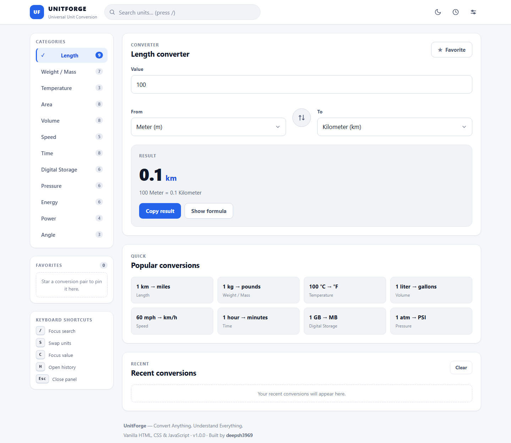
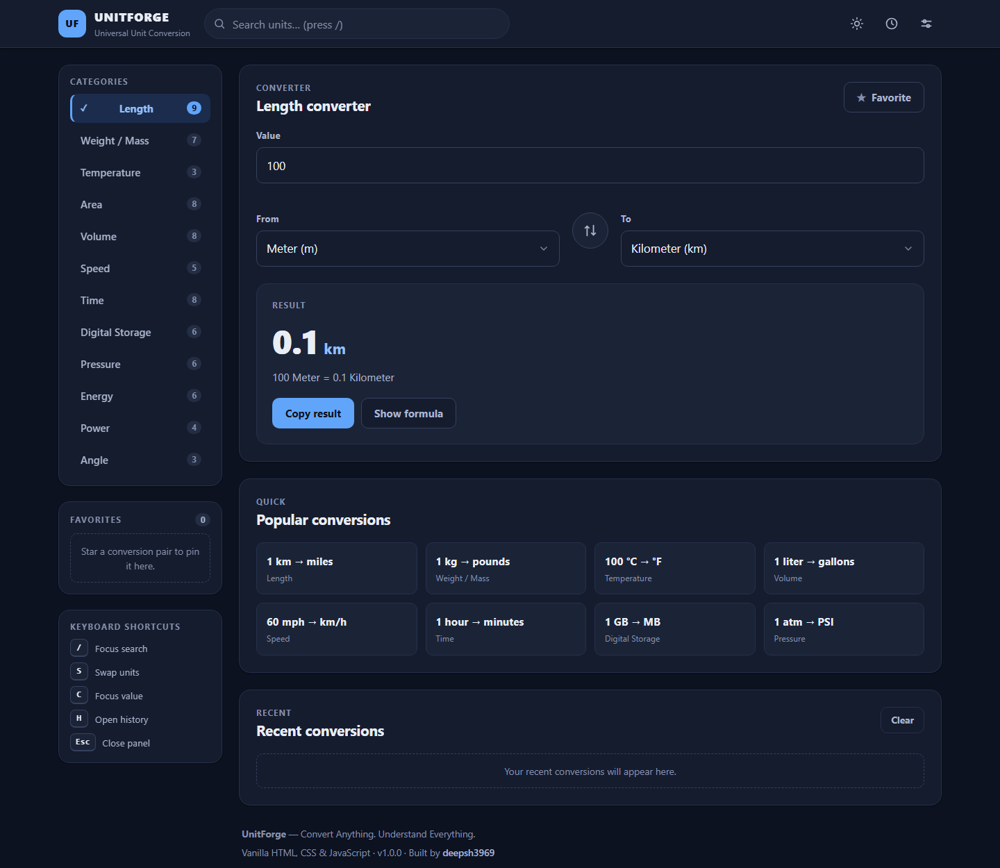
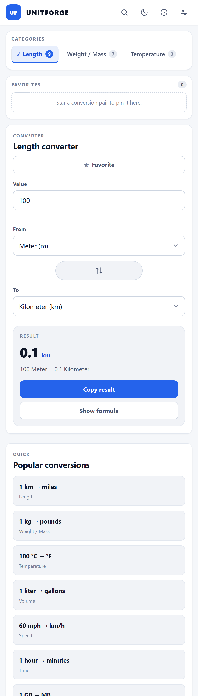

# UnitForge

**Convert Anything. Understand Everything.**

A fast, accessible, multi-category unit conversion platform built with plain
HTML, CSS and JavaScript - no frameworks, no build step, no dependencies.

---

## Table of contents

1. [Overview](#overview)
2. [Features](#features)
3. [Screenshots](#screenshots)
4. [Tech stack](#tech-stack)
5. [Getting started](#getting-started)
6. [Project structure](#project-structure)
7. [Categories and units](#categories-and-units)
8. [Conversion engine](#conversion-engine)
9. [Keyboard shortcuts](#keyboard-shortcuts)
10. [Settings and storage](#settings-and-storage)
11. [Testing](#testing)
12. [Accessibility](#accessibility)
13. [Browser support](#browser-support)
14. [Deployment](#deployment)
15. [Roadmap](#roadmap)
16. [Contributing](#contributing)
17. [License](#license)

---

## Overview

UnitForge is a single-page unit converter that behaves like a product rather
than a demo: results update as you type, every unit is searchable, favorites
and history survive reloads, three themes are built in, and the layout works
from a 360px phone up to a wide desktop.

Everything runs client-side. Open `index.html` and it works.

## Features

- **12 categories, 73 units** - length, mass, temperature, area, volume,
  speed, time, digital storage, pressure, energy, power and angle.
- **Live conversion** - results update on every keystroke with an
  `aria-live` region and a plain-language summary line.
- **Global search** - fuzzy matching across names, symbols and aliases;
  compact queries such as `kmh` resolve to *Kilometer/Hour*; arrow keys and
  Enter to activate.
- **Favorites** - star any conversion pair and pin it to the sidebar.
- **Recents and history** - the last 10 conversions on the page, the last 50
  in the history panel, each restorable in one click.
- **Formula breakdown** - expand the result to see how the number was
  derived, including the Celsius pivot used for temperature.
- **Copy result** - one click, with a toast confirmation.
- **Swap** - exchanges the two units and keeps your value.
- **Themes** - system / light / dark, CSS-driven with a JavaScript fallback,
  plus `theme-color` syncing for mobile browsers.
- **Precision control** - `auto` (removes floating point noise) or a fixed
  2 / 4 / 6 / 8 decimals.
- **Animations and sound feedback** - both optional and individually
  switchable.
- **Zero dependencies** - no `npm install`, no bundler, no transpiler.

## Screenshots

| Light | Dark |
| --- | --- |
|  |  |

| Mobile (single column, chips navigation) |
| --- |
|  |

Screenshots are captured from the running page with headless Chrome and are
not retouched.

## Tech stack

| Layer | Choice |
| --- | --- |
| Markup | Semantic HTML5 |
| Styling | CSS custom properties, Flexbox and Grid, no preprocessor |
| Logic | ES5-compatible vanilla JavaScript, IIFE modules on a `UF` namespace |
| State | `localStorage` with an in-memory fallback |
| Tests | Node runner, in-browser harness and a headless UI smoke script |

Scripts are loaded with ordered `<script>` tags instead of ES modules so the
application also works when opened directly from `file://`.

## Getting started

No installation required.

```bash
git clone https://github.com/deepsh3969/UnitForge.git
cd UnitForge
```

Open `index.html` in a browser, or serve the folder over HTTP:

```bash
npx serve .                 # or
python -m http.server 8080
```

Then visit `http://localhost:8080`.

## Project structure

```
UnitForge/
├── index.html                 # single page application shell
├── css/
│   ├── style.css              # design tokens, layout, header, converter
│   ├── components.css         # buttons, cards, panels, search, lists
│   └── responsive.css         # breakpoints 1140 / 980 / 860 / 760 / 600 / 420 / 360
├── js/
│   ├── units.js               # category and unit catalogue, defaults
│   ├── utils.js               # number formatting, value parsing, DOM helper
│   ├── conversionEngine.js    # convert() and getFormula()
│   ├── storage.js             # localStorage wrapper with memory fallback
│   ├── search.js              # unit index, fuzzy and compact scoring
│   ├── ui.js                  # rendering, panels, search results, theming
│   └── app.js                 # state, recalculation flow, events, shortcuts
├── assets/
│   ├── icons/favicon.svg
│   └── screenshots/           # light, dark and mobile captures
├── tests/
│   ├── suite.js               # 77 assertions (engine, search, storage, data)
│   ├── run-tests.js           # Node runner
│   ├── browser.js + test.html # the same suite in the browser
│   └── smoke.js               # 51-step headless UI interaction harness
├── README.md
├── CHANGELOG.md
├── LICENSE
└── .gitignore
```

Script load order matters: `units.js` -> `utils.js` -> `conversionEngine.js`
-> `storage.js` -> `search.js` -> `ui.js` -> `app.js`.

## Categories and units

| Category | Units |
| --- | --- |
| Length | Millimeter, Centimeter, Meter, Kilometer, Inch, Foot, Yard, Mile, Nautical Mile |
| Weight / Mass | Milligram, Gram, Kilogram, Metric Ton, Ounce, Pound, Stone |
| Temperature | Celsius, Fahrenheit, Kelvin |
| Area | Square Millimeter, Square Centimeter, Square Meter, Square Kilometer, Square Inch, Square Foot, Acre, Hectare |
| Volume | Milliliter, Liter, Cubic Meter, Cubic Centimeter, Gallon (US), Quart (US), Pint (US), Cup (US) |
| Speed | Meter/Second, Kilometer/Hour, Mile/Hour, Foot/Second, Knot |
| Time | Millisecond, Second, Minute, Hour, Day, Week, Month, Year |
| Digital Storage | Bit, Byte, Kilobyte, Megabyte, Gigabyte, Terabyte |
| Pressure | Pascal, Kilopascal, Bar, Atmosphere, PSI, mmHg |
| Energy | Joule, Kilojoule, Calorie, Kilocalorie, Watt-hour, Kilowatt-hour |
| Power | Watt, Kilowatt, Megawatt, Horsepower |
| Angle | Degree, Radian, Gradian |

Units are declared once in `js/units.js` with a base factor (or an explicit
temperature pivot), a symbol, aliases for search, and a per-category default
pair. Adding a unit is a single object literal - no other file changes.

## Conversion engine

```js
UF.engine.convert(100, "length", "m", "km", { precision: "auto" });
// { ok: true, value: 0.1, formattedValue: "0.1",
//   fromUnit: "m", toUnit: "km", category: "length", ... }

UF.engine.convert("abc", "length", "m", "km");
// { ok: false, error: "invalid-value" }
```

Failures are returned as data (`invalid-value`, `unknown-unit`,
`category-mismatch`), never thrown, so the UI can render inline messages.

```js
UF.engine.getFormula("temperature", "c", "f", "auto");
// [ "F = (C x 9/5) + 32", ... ]
```

Linear categories convert through a base factor; temperature converts
through explicit to-Celsius / from-Celsius maps so offsets stay correct.

## Keyboard shortcuts

| Key | Action |
| --- | --- |
| `/` | Focus global search |
| `S` | Swap the two units |
| `C` | Focus and select the value field |
| `H` | Toggle the history panel |
| `Esc` | Close search results, then the open panel |

Shortcuts are ignored while focus is inside an input, select, textarea or
content-editable element, and modifier combinations are left to the browser.

## Settings and storage

Settings live behind the sliders icon: theme (system / light / dark),
decimal precision, animations and sound feedback.

Everything is persisted in `localStorage` under the `unitforge:` prefix:

| Key | Contents |
| --- | --- |
| `unitforge:settings` | theme, precision, animations, sound |
| `unitforge:favorites` | starred conversion pairs |
| `unitforge:recent` | last 10 conversions shown on the page |
| `unitforge:history` | last 50 conversions in the history panel |

If `localStorage` is unavailable (private mode, `file://` restrictions), the
storage layer silently falls back to an in-memory store for the session.

## Testing

```bash
# Node: engine, units, search, storage and data integrity
node tests/run-tests.js
```

```text
77/77 tests passed
```

In-browser suite: open `tests/test.html` - it runs the same
`tests/suite.js` and prints a summary with an overall pass or fail banner.

Headless UI smoke harness (51 interaction and console checks):

1. Copy `index.html` to a temporary file (for example `smoke-tmp.html`).
2. Inject `tests/smoke.js` before `</body>` of that copy.
3. Open the copy with headless Chrome and read the injected
   `SMOKE_RESULT` global, which reports
   `{"total":51,"failed":0,"failures":[]}`.

The harness exercises category switching, typing, unit selection, swap,
favorite toggle, copy, formula expansion, search, panels, theme switching,
shortcuts and responsive behaviour, and asserts that the console stays free
of errors.

Honest notes on coverage: automated tests do not cover every browser, visual
regressions are only checked by eye against the committed screenshots, and
the smoke harness runs at desktop width plus two reduced layouts - very
narrow viewports below 400px were verified manually rather than
automatically.

## Accessibility

- Skip link to the converter, landmark elements and labelled controls.
- Result region announced with `aria-live="polite"` and `aria-atomic`.
- Dialog panels use `role="dialog"`, `aria-modal`, focus trapping on open
  and focus restoration on close.
- Search is a `combobox` with `aria-expanded`, `aria-controls`, a `listbox`
  of results and arrow-key navigation.
- Visible focus rings throughout, minimum 4.5:1 text contrast in both
  themes, and `prefers-reduced-motion` respected when animations are on.

## Browser support

Targets current evergreen browsers: Chrome, Edge, Firefox and Safari
(latest two major versions), desktop and mobile. The JavaScript is written
in an ES5-compatible style (var, function declarations, no optional
chaining), so older engines are likely to work as well, but they are not
tested.

Known limitations:

- Sound feedback uses the Web Audio API and is silent where it is
  unavailable.
- Extremely narrow viewports below 360px are outside the tested range.

## Deployment

The site is fully static, so any static host works.

**Vercel**

```bash
npm i -g vercel
vercel          # accept the defaults, framework preset: Other
```

**GitHub Pages**

1. Repository -> Settings -> Pages.
2. Source: `Deploy from a branch`, branch: `main`, folder: `/ (root)`.
3. The site appears at `https://deepsh3969.github.io/UnitForge/`.

No environment variables, build command or output directory is required -
the published artifact is the repository itself.

## Roadmap

- PWA install prompt with an offline shell (the app already works offline).
- Custom conversions: define your own unit and base factor.
- Multi-conversion view: show a whole category at once for one value.
- Shareable URLs encoding value, category and unit pair.
- Unit-of-the-day and conversion history export.
- Localisation of unit names and interface strings.

## Contributing

Issues and pull requests are welcome.

1. Fork and create a feature branch.
2. Keep the no-dependency, no-build constraint; follow the existing IIFE
   and `UF.*` namespace style.
3. Add tests to `tests/suite.js` for engine or data changes, then run
   `node tests/run-tests.js` and confirm the smoke harness still reports
   zero failures.
4. Open a pull request describing the change and how it was verified.

## License

MIT - see [LICENSE](LICENSE).
